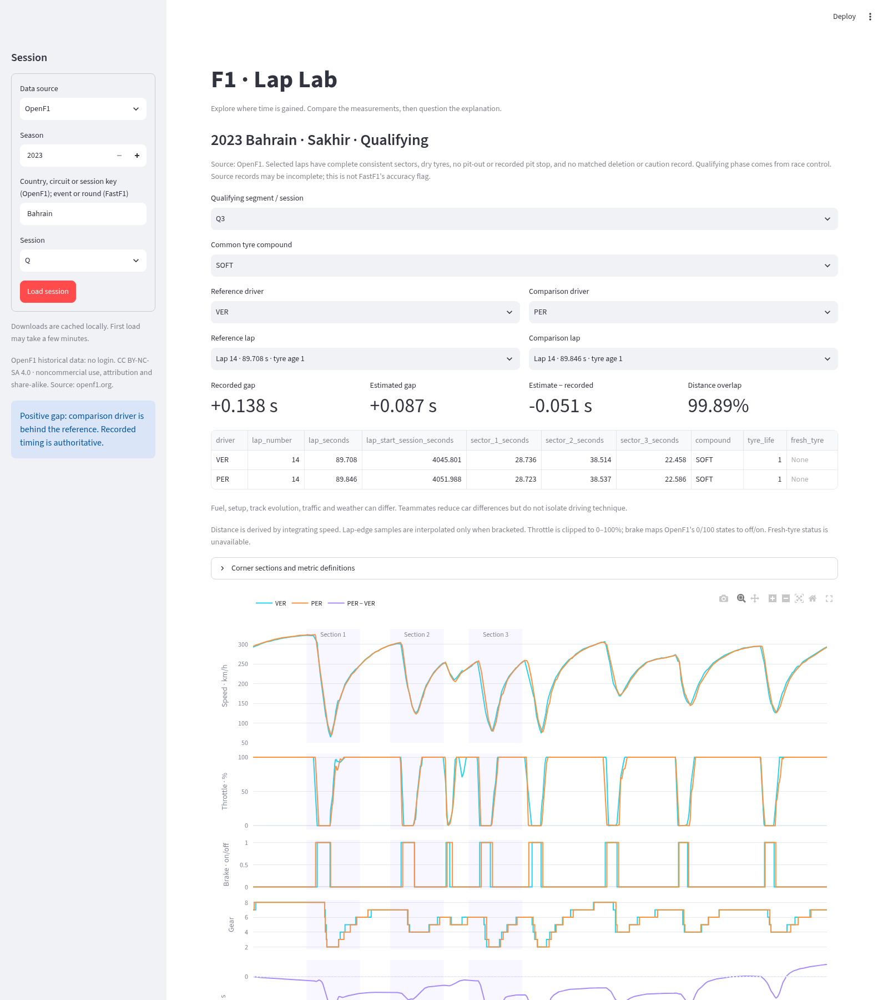

# F1 Telemetry & Lap Performance Analyser

**Where did one driver gain time, and what do the measurements show?**

Compare historical Formula 1 laps in a Streamlit dashboard: recorded lap/sector
summaries, speed, throttle, brake and gear overlays, an approximate time-gap trace,
and three adjustable braking sections. The default source is **OpenF1**, with real
2023 Bahrain, Monza and Abu Dhabi qualifying snapshots bundled for offline use.
**No account, API key or subscription is required for those examples.**

## Run

Python 3.11+; verified with Python 3.12.14. From the repository root:

```bash
python -m venv .venv
source .venv/bin/activate  # Windows: .venv\Scripts\activate
python -m pip install -r requirements.lock
python -m pip install --no-deps -e .
python -m streamlit run app.py
```

In this cloud environment the checkout is `/workspace/F1-telemtry` and `.venv` is
already installed. Select **OpenF1 / 2023 / Bahrain / Q**, press **Load session**,
then use **Q3 / SOFT / VER / PER**. Fastest eligible laps are selected by default.
Use Monza or Abu Dhabi for the other bundled examples. OpenF1 accepts country,
circuit or numeric session key (not championship round number). Other selections
may need network access and downloads. Ambiguous selections produce an error.



## Open data and provenance

To publish the interactive website, follow [the deployment guide](DEPLOYMENT.md).
The repository includes a Streamlit configuration and `requirements.txt` for
Streamlit Community Cloud. A public hosted URL is available only after deploying.

Data: [OpenF1 contributors](https://openf1.org/),
[CC BY-NC-SA 4.0](https://creativecommons.org/licenses/by-nc-sa/4.0/).
Use noncommercially, retain attribution, identify modifications and share adapted
material under the same terms. Bundled snapshots and derived reports retain that
licence. These terms do not imply OpenF1 or Formula 1 endorsement.
See [dataset attribution and full licence](datasets/openf1/README.md).

The bundle contains unchanged API response data, query URLs, retrieval timestamps
and SHA-256 hashes. The loader checks each bundled response against the manifest.
It prefers the bundle, then `.cache/openf1/`, then rate-limited HTTPS requests
(less than 30 requests/minute). Network failures never become synthetic data.
Queries outside the bundle require access to `api.openf1.org`. OpenF1 can temporarily
restrict **all downloads, including historical data, during live F1 sessions**.
The lap selector marks bundled laps as “offline snapshot”; those work throughout
such restrictions. Download failures show recovery guidance and a retry button.

FastF1 remains an optional dashboard source. Its original authenticated telemetry
route is not needed for OpenF1. See [data access](reports/DATA_ACCESS.md) before
using it. Download caches, environments and login files must stay out of Git.

## Analysis and limitations

- OpenF1 lap selection requires complete sector timing summing within 0.020 s of
  the lap duration, a dry compound and stint metadata. It excludes pit-out laps,
  recorded pit stops, matched deleted laps and laps intersecting caution records
  or starting under a recorded non-green track state. Qualifying phase is taken
  from explicit race-control phase records. These checks depend on source
  completeness and are **not** FastF1's `IsAccurate` flag. Qualifying laps more
  than 7% slower than that driver's best eligible lap in the same segment are
  excluded as a cooldown/in-lap heuristic; this is not the FIA 107% rule.
- Deletion messages are matched by driver and reported duration where available:
  race-control and API lap numbers can differ. Without a duration, both adjacent
  number candidates are conservatively excluded. Reinstated laps stay excluded.
- Speed is km/h, throttle is clipped to 0–100% (source values can exceed 100), brake
  maps 0/100 to off/on, and gear is discrete. Brake does not measure pressure.
- Telemetry must bracket lap boundaries. Boundary speed/throttle are interpolated;
  gear and brake use previous-sample hold. Distance is trapezoidally integrated
  from speed, not measured track position. It is not stretched to fit a circuit.
- Reject non-finite/invalid channels, unordered timestamps, gaps above 1.5 s,
  inadequate lap-time coverage and distance overlap below 98%. Bahrain has a
  median sample interval of 0.24 s but gaps up to 1.24 s: fine timing/position
  differences can be smaller than sampling uncertainty.
- Continuous channels align on a 5 m shared-distance grid; discrete channels use
  previous-sample hold. Integrate reciprocal speed to estimate elapsed time.
  Gap = comparison minus reference: **positive means comparison behind**.
  Recorded timing remains authoritative. Warn when estimated minus recorded gap
  exceeds 0.100 s in magnitude or overlap is below 99.5%.
- Section metrics use original samples: first brake off→on transition in the
  window, minimum sampled speed, first return to ≥95% throttle after the minimum,
  and high-throttle elapsed time (interval weighting, not sample counts).
  Unknown transitions remain missing. Braking sections are proposals, not corner IDs.
- Tyre age, fuel, setup, traffic, weather and track evolution are not controlled.
  Fresh-tyre status is unavailable in this adapter. Teammates help comparison but
  do not isolate driving technique. Small finish error does not validate local
  alignment; speed-derived distances can drift and exaggerate transient gaps.

## Results and reproducibility

```bash
python -m pytest -q
python scripts/analyse_sessions.py --all
```

All **58 tests pass**, including the three real-snapshot comparisons with network
calls disabled. Real-session report generation succeeds for all three sessions;
self-comparison gives zero and swapping laps reverses the gap's sign.

| 2023 Q3, VER vs PER | Recorded gap (s) | Estimate (s) | Estimate − recorded (s) |
| --- | ---: | ---: | ---: |
| Bahrain | +0.138 | +0.087 | −0.051 |
| Monza | +0.381 | +0.453 | +0.072 |
| Abu Dhabi | +0.726 | +0.602 | −0.124 |

Abu Dhabi triggers the accuracy warning; successful execution does not mean the
estimate matches official timing within 0.100 s. See [validation status](reports/STATUS.md).

The exporter writes `reports/generated/<session>/case-study.md`, `summary.json`,
`aligned.csv`, `comparison.png` and standalone `telemetry.html` files with Plotly
bundled locally. `validation.json` records the current run and failures cause a
nonzero exit. Reruns reuse snapshots and need no download for these comparisons.

Read the [reviewed Bahrain case study](reports/BAHRAIN_CASE_STUDY.md), including
three annotated observations and sampling caveats. The automated per-session
reports are measurement summaries, not independent causal explanations.

## Notebooks and project layout

- `notebooks/01_bahrain_first_lap.ipynb`: executed real lap, first speed plot and
  VER/PER Q3 analysis. Select `.venv/bin/python` as the notebook kernel.
- `notebooks/02_method_validation.ipynb`: executed synthetic analytical checks,
  clearly separate from historical evidence.
- `src/f1_analyser/`: calculations, OpenF1/FastF1 adapters and plotting.
- `tests/`: analytical invariants, source parsing, integrity checks, real offline
  data and Streamlit integration tests.
- `datasets/openf1/`: attributed real snapshots and manifest.
- `reports/`: case study, figures, dashboard screenshot and validation evidence.
- `scripts/bundle_open_data.py`: preserves downloaded public queries and provenance.
- `.github/workflows/tests.yml`: automated offline tests.

A defensible CV description: “Built a Python/Streamlit F1 telemetry analyser,
aligning signals by distance and validating lap-gap estimates across three
historical qualifying sessions; implemented 58 automated checks and documented
sampling and data-quality limitations.” This is an independent educational project.
