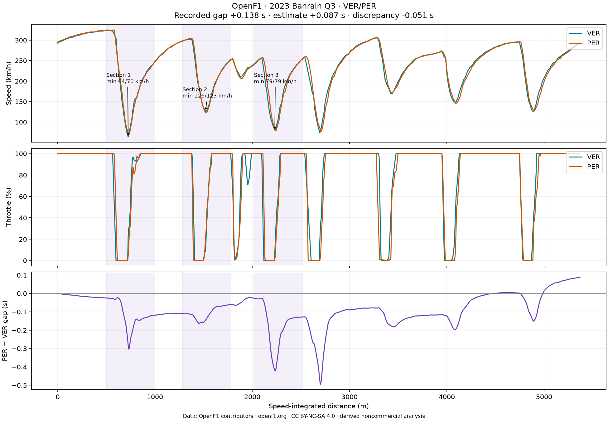

# Bahrain 2023 qualifying: Verstappen vs Pérez

Question: where does the telemetry show different lap behaviour, and how much
confidence can we place in the apparent gains?

Data: **OpenF1 contributors**, https://openf1.org/, **CC BY-NC-SA 4.0**.
This noncommercial derived analysis and its figures are shared under the same
licence. Modifications: lap filtering, channel mapping, boundary interpolation,
speed-integrated distance, shared-grid alignment and derived metrics.

## Selection and authoritative timing

Both drivers' selected laps are OpenF1 lap **14**, Q3, SOFT, estimated tyre age
**1 lap**. Fresh-tyre status is unknown. OpenF1 and race-control numbering can
differ: the adapter matches reported deleted times to source durations rather
than assuming identical numbering. Neither selected duration matches a deletion.
The phase comes from race-control Q3 green-light records, not an assumed clock window.

| Driver | Lap | Sector 1 | Sector 2 | Sector 3 | Lap time |
| --- | ---: | ---: | ---: | ---: | ---: |
| VER | 14 | 28.736 s | 38.514 s | 22.458 s | 89.708 s |
| PER | 14 | 28.723 s | 38.537 s | 22.586 s | 89.846 s |

Pérez is **0.138 s slower overall**. Recorded timing gives him 0.013 s in sector
1, while Verstappen gains 0.023 s in sector 2 and 0.128 s in sector 3. These
timing differences have stronger support than a precise attribution to a corner.

## Three observations from the reviewed sections

These windows were proposed from braking transitions and checked against the
speed/throttle plot. They are distance sections, not surveyed corner coordinates.
Positive estimated gap means Pérez is behind; a negative change means an apparent
gain for Pérez over that window.

| Section | Distance window | Minimum speed VER / PER | First ≥95% throttle return VER / PER | Estimated gap change |
| --- | --- | --- | --- | ---: |
| 1 | 500–1000 m | 64 / 70 km/h | 770 / 814 m | −0.094 s |
| 2 | 1284–1784 m | 126 / 123 km/h | 1585 / 1580 m | +0.050 s |
| 3 | 2018–2518 m | 79 / 79 km/h | 2286 / 2292 m | −0.102 s |

1. **The first section shows a tradeoff between minimum speed and throttle
   return.** Pérez's sampled minimum is 6 km/h higher, but Verstappen first
   reaches 95% throttle about 44 m earlier after the minimum. The exit traces
   converge. The estimated section gain favours Pérez; it does not establish
   that either braking technique is better. Brake onsets are approximately
   600 m (VER) and 583 m (PER), a 17 m difference that is close to the source's
   typical distance sampling interval.

2. **The second section has a small speed difference and nearly coincident
   throttle return.** Verstappen's minimum is 3 km/h higher; first high-throttle
   return differs by only about 5 m. That position difference is too small to
   distinguish confidently at this sampling rate. The estimated gap change
   favours Verstappen by about 0.050 s. This is an observation from the aligned
   signals, not an independently timed corner gain.

3. **Equal minimum speed does not imply identical approach and exit.** Both
   drivers reach 79 km/h in the third section. Their recorded brake onsets are
   approximately 2118 and 2130 m, and throttle returns differ by about 6 m.
   Those small positional differences are uncertain. The estimated trace swings
   strongly near the minimum and recovers, finishing the window with an apparent
   0.102 s gain for Pérez. This is a useful example of why transient gap peaks
   should not be reported as measured corner gains without spatial validation.

## Validation and uncertainty

- The estimate finishes at **+0.087 s**, compared with recorded **+0.138 s**:
  discrepancy **−0.051 s**. Shared-distance coverage is **99.89%**.
- Self-comparison gives zero; swapping reference/comparison reverses the sign.
  These checks catch software errors but cannot establish spatial accuracy.
- Median sample interval is 0.24 s; maximum observed interval is 1.24 s for both
  laps. There are 320/326 processed samples, including interpolated boundaries.
  Median distance increments are about 15.3/14.7 m. Quoted metres are computed
  positions and do not imply metre-level accuracy.
- Integrated distances are approximately 5368.9 m and 5375.0 m. The 6.1 m
  disagreement alone can shift apparently corresponding braking/exit points.
  Distance is derived from sampled speed, not an independent position channel.
- Brake is binary, not pressure. High-throttle means ≥95% and its duration is
  weighted by time intervals. Interpolated channels and sparse samples limit
  transition precision. The method is not forced to match the recorded gap.
- Timing completeness and source race-control/stint records are checked; their
  completeness is not independently guaranteed. Traffic, fuel, car setup,
  weather and track evolution are not controlled. Same team, segment, compound
  and stated tyre age reduce some differences but do not prove identical cars
  or conditions.

The defensible finding is that the selected laps have measurable differences in
sampled speed and throttle profiles, while official timing places the largest
net sector difference in sector 3. The available data does not isolate the cause
or support precise claims about brake pressure or driver skill.

## Reproduce

Run `python scripts/analyse_sessions.py --all` from the repository root. Read
`generated/2023-bahrain/summary.json` and the interactive `telemetry.html` alongside
the CSV. `notebooks/01_bahrain_first_lap.ipynb` contains executed real-data outputs.
The dataset manifest records exact source queries, timestamps and hashes.
